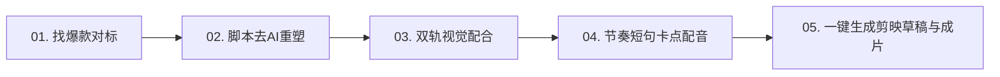

# 🎬 副业核心项目库 (D:\fuye)

> **核心定位**：全自动化文化/文旅/图书带货爆款短视频生产线  
> **生产闭环**：对标爆款数据采集 ➔ 选题文案去AI化改写 ➔ 金牌配音合成 ➔ 分镜与Ken Burns镜头运动 ➔ 爆款字幕合成 ➔ 剪映草稿自动生成

---

## 📁 目录结构总览

```text
D:\fuye\
│
├── 00_对标与采集工具\                  # [数据挖掘] 爆款监控与全自动批量下载
│   ├── DouK-Downloader\              # 抖音批量采集与 Excel 指标导出工具
│   ├── wx_channel\                   # 视频号解密监听与批量下载工具
│   ├── 启动_抖音批量下载与分析.bat    # 抖音一键启动快捷脚本
│   └── 启动_视频号批量下载.bat        # 视频号一键启动快捷脚本
│
├── 01_配音与音色库\                    # [音频资产] 沉淀的最佳音色配置与试音样本
│   ├── selected_voices.json          # 锁定的金牌音色配置（1号/3号/5号）
│   ├── 01_央视纪录片_沧桑历史男声.mp3  # 1号音色（最适合宏大历史、古建奇迹）
│   ├── 03_文化讲书_自然叙事男声.mp3  # 3号音色（最适合文化漫谈、娓娓道来）
│   ├── 05_三晋风味_关中厚重女声.mp3  # 5号音色（特色地域韵味）
│   └── 试音样本\                     # 其他候选与备用音色样例
│
├── 02_公共资产库\                      # [公共素材] 通用字体、包装模板、实拍图库
│   ├── 字体库\ (STXINGKA.TTF 等)     # 华文行楷、微软雅黑加粗等商业美化字体
│   ├── 视觉模板\                     # 爆款金牌封面包装底图与边框
│   └── 真实影像素材池\               # 高清无版权真实古建/文物高清原图
│
├── 03_视频成片与工程\                  # [作品归档] 每一期视频的全流程工程文件
│   ├── 01_山西古建三大奇迹\           # 【第1期】成品工程
│   │   ├── 01_文案与分镜\             # 脚本、分镜表、39句卡点字幕 (SRT)
│   │   ├── 02_分镜视觉素材\           # 史诗封面、真实古建照片、3D爆炸图
│   │   ├── 03_配音音频\               # 39句分段音频与完整合成主音轨
│   │   ├── 04_剪映草稿工程\           # 一键注入剪映专业版脚本
│   │   └── 05_高清成片导出\           # 最终渲染成片 (短句爆款字幕版.mp4)
│   └── 02_待定选题模版\               # 【标准化模版】后续期数复制即用
│
└── 04_自动化生产流水线\                # [生产引擎] 核心自动化合成与草稿生成脚本
    ├── build_rhythmic_subtitles.py    # 爆款短句卡点字幕+运镜渲染+剪映草稿一体化流水线
    └── create_gpt_cover.py            # 书法大字+史诗级画面的高转化封面生成器
```

---

## 🎙️ 锁定音色配置表 (`selected_voices.json`)

| 编号 | 音色名称 | 引擎标识 (Edge-TTS) | 语速 (Rate) | 音调 (Pitch) | 适用场景 |
| :---: | :--- | :--- | :---: | :---: | :--- |
| **1号** | 央视纪录片·沧桑历史男声 | `zh-CN-YunjianNeural` | -8% | -6Hz | 宏大历史、古建筑、国宝文物奇迹（本期默认使用） |
| **3号** | 文化讲书·自然叙事男声 | `zh-CN-YunxiNeural` | -4% | -1Hz | 书籍推荐、文化漫谈、知识科普 |
| **5号** | 三晋风味·关中厚重女声 | `zh-CN-shaanxi-XiaoniNeural` | -4% | 0Hz | 地域特色古迹、民间风物故事 |

---

## 🚀 短视频爆款带货 SOP 标准工作流



1. **找爆款对标**：
   * 运行桌面的 `抖音爆款下载分析 (DouK)`，输入对标博主链接，导出 Excel 表格，按点赞量降序挑出验证过的大爆款。
   * 或运行 `视频号下载分析 (wx_channel)`，在微信端抓取中老年高互动视频。
2. **脚本去AI重塑**：
   * 黄金前3秒（Hook）：制造极致反差或权威数据。
   * 正片内容：严谨故事化拆解（拒绝“空洞华丽”，讲透硬核物理/历史事实）。
   * 结尾转化（CTA）：由文物价值自然过渡到图书或文旅产品推荐。
3. **视觉双轨策略**：
   * **封面 & 尾页**：使用顶级 GPT 史诗画面（悬崖、宏大氛围）与 3D 力学结构爆炸图。
   * **正片中段**：100% 采用真实历史实景摄影，保证严肃性与真实可信度，彻底摆脱“假AI味”。
4. **字幕与排版**：
   * 采用“短句爆款字幕”（每屏仅 5~9 字，大字纯白加粗 + 纯黑重描边）。
   * 位置居于屏幕中下方（垂直高度 65% 左右），避开平台点赞与评论按钮。
5. **一键生成**：
   * 运行自动化脚本直接渲染高清成片，同时一键注入剪映专业版，可在剪映中直接微调或二次混剪。

---

## 🖥️ 桌面快捷方式

系统已在你的 Windows 桌面上建立了 3 个快捷方式：
* **`抖音爆款下载分析 (DouK)`**：直接双击启动抖音采集。
* **`视频号下载分析 (wx_channel)`**：直接双击启动视频号解密监听。
* **`副业核心工作台 (D盘 fuye)`**：一键直达本目录。
