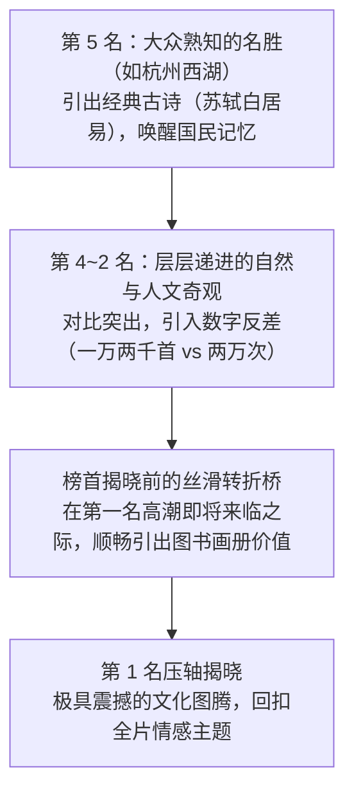

# 赛道规范：锦绣千秋录（国风山水与半生诗意）

> **赛道定位**：文学底蕴极深、视听审美高级的国风人文地理爆款母体。主打“古诗词里的中国”、“古建国宝工程”、“岁月沉淀与半生乡愁”。  
> **声学基准**：Edge-TTS `zh-CN-YunjianNeural`（沉静从容、文史底蕴极高，语速 -8%，音调 -6Hz） + 原版国风悠扬温情 BGM（`bgm_shili_guofeng.mp3`，音量 -13.0dB）。  
> **语料基数**：基于全量 19 篇深度逆向校准。

---

## 一、 标志性叙事节拍与倒叙榜单骨架

### 1. 标志性开篇与仪式感过门
* **固定仪式感口播**：
  > `“您知道中国秋天最有诗意的湖泊是哪一个吗？上集咱们聊了瘦西湖、长白山天池、洱海、纳木错。这一集直接揭开谜底，看看前五名诗意到了什么程度！话不多说，茶给您沏好了，劳烦您顺手点个小红心，咱们这就开讲！”`
* **节拍心法**：用一句“茶给您沏好了”瞬间将嘈杂的信息流拉入安详闲适的茶舍氛围，让观众放慢脚步。

---

### 2. 倒叙揭晓（第5名到第1名）推进模板

#### ① [第五名到第二名铺垫：诗文与数字强反差]
> `“第五名：杭州西湖。这个名字不用多介绍，小学课本里就有它。它不过六平方公里多，却被叫了一千年的人间天堂。苏东坡来了修了苏堤，白居易来了修了白堤。秋天的西湖，月亮一出来，湖面泛着荧光，满觉陇的桂花被风一吹落进水里，香气都浮在水面上……”`

#### ② [榜首揭晓前的丝滑带货转折]
> `“老祖宗留给咱们的这片山水，每一处都泡在诗词里。光在手机里看几眼不过瘾，这套大字精装的《唐诗宋词里的中国地理》，把唐宋诗人一辈子的行迹地图和神州壮丽山河收录成了全彩画卷。要是暂时走不开，把它放在茶几案头，老两口晚饭后喝口茶翻两页，指着画册商量明年去哪走走，心就已经游遍了千山万水。”`

#### ③ [第一名压轴登场：升华文化认同]
> `“好，咱们揭晓天下第一的诗意榜首——它不在江南，而藏在雪域高原与草海交界的地方！岸边的草海在深秋黄成一片金毯子，至今保留着老祖宗最初的纯净与从容……”`

---

## 二、 核心题材写作规范

### 1. 题材一：【古建筑与古代超级工程】
* **叙事重心**：严禁干瘪报尺寸。重点讲“扛过了多少次天灾人祸”与“无钉无铆的木构奇迹”。
* **典型句式**：
  > `“断了梁的殿、抽掉柱的堂，两千两百年的工程今天还在给几千万人供水，一片壁画却在一天天褪色。比悬空寺还不可思议的山西木构，榜首那座高六十七米，扛过几十次地震和两百多发炮弹，依然傲立在天地之间！”`

### 2. 题材二：【古城诗词与文人风骨】
* **叙事重心**：不讲 GDP 和现代化，只讲“哪个诗人在此哭过知己”、“哪座城装满回家两个字”。
* **典型句式**：
  > `“写它们的诗加起来好几万首，排第一的那座城，名字只有两个字，在唐宋诗词里被念了一万四千多次！一万两千首绝唱都只能排第二，第一名装的全是全天下读书人一辈子的指望！”`

---

## 三、 图书转化与情感收束原则

* **高转化商品画像**：中国国家地理大画册、手绘中国古建筑、唐诗宋词地图集。
* **优雅收束台词**：
  > `“山水是大地的诗，书本是案头的山河。带一套正版画册回家，给家里添一抹书香与宁静。左下角小黄车已备好，喜欢的朋友顺手带一套，咱们下期接着品！”`
