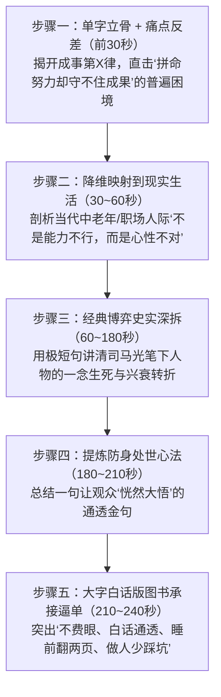

# 赛道规范：元宝与资治通鉴（成事七律与心性认知）

> **赛道定位**：高认知密度、高转发率的文史通识与处世智慧爆款母体。主打“古人智慧照进现实”、“中年心性破局”、“大字白话读通史”。  
> **声学基准**：Edge-TTS `zh-CN-YunjianNeural`（字正腔圆纪录片男声，语速 -8%，音调 -6Hz） + 沉稳中带有历史回响的国风配乐（音量 -13.0dB）。  
> **语料基数**：基于全量 95 篇深度逆向校准。

---

## 一、 核心工业化母体：【《资治通鉴》成事七律 / 人生局系列】

该系列为 95 篇语料中最具商业变现与 IP 复制价值的结构化母体（命中达 10+ 篇）。通过将司马光笔下 1,362 年的政治博弈降维映射到普通人的生活人际是非，具有极强的说服力。

### 1. 成事七律字诀体系与主题映射表

| 系列编号 | 核心单字 / 局名 | 人生底层痛点症结 | 匹配历史博弈案例 | 核心记忆金句 |
| :--- | :--- | :--- | :--- | :--- |
| **第一律** | **【稳】** | 心浮气躁、急于求成、攒不住成果 | 汉文帝入京即位、萧何关中营建 | “稳，是普通人走远路的重要底气。胜不轻狂，败不失态。” |
| **第二律** | **【忍】** | 逞一时口舌之快、过早亮底牌 | 越王勾践卧薪尝胆、司马懿装病伏曹爽 | “真正的强者，不是赢在爆发，而是赢在能忍。忍是蓄力。” |
| **第三律** | **【明】** | 识人不明、轻信蜜语、看不透利害 | 智伯之亡、侯景叛梁、杨广夺嫡 | “困住你的往往不是没钱没人，而是看不透人性背后的利益网。” |
| **第四律** | **【决】** | 优柔寡断、当断不断反受其乱 | 鸿门宴项羽失机、高平之战郭威立威 | “决，是破局的唯一能力。有些门轻轻带上，反而比推开更需要魄力。” |
| **进退局** | **【知止】** | 功高震主、贪功冒进、不懂顺势收手 | 张良急流勇退、范蠡泛舟五湖 | “花繁柳密处拨得开，才是手段；风狂雨急时立得定，方见脚跟。” |
| **心性局** | **【沉潜】** | 本事很大却心性脆弱、输不起 | 诸葛亮鞠躬尽瘁、苏东坡乌台诗案 | “所有本事拼到最后，拼的都是心性。事来则应，事过心清。” |

---

### 2. 标准五步工业化行文骨架

#### ① [第一步：单字立骨与痛点反差（前 120 字）]
> `“《资治通鉴》成事七律·第[X]律：[字]。[字]，是普通人走远路的重要底气。很多人天天吃苦、努力、折腾，却始终突破不了瓶颈、守不住局面。不是你眼界不够，也不是能力不行，而是不懂得这个[字]的分量。通读《资治通鉴》一千三百多年兴衰，你会发现所有能成大器的人，无一例外都在这一个字上下足了笨功夫！”`

#### ② [第二步：现实生活痛点具象化]
> `“您细品身边那些吃大亏的人：做生意一赚到钱就急着扩张，最后血本无归；在人际交往里别人两句奉承就掏心掏肺，转头就被人当枪使；甚至在家里，明知孩子有自己的想法，却忍不住天天念叨挑刺，结果关系越搞越僵。说白了，咱们大部分人生病、破财、惹是非，都是因为做不到这个‘[字]’！”`

#### ③ [第三步：历史经典博弈故事深拆（以智伯之亡/司马懿为例）]
> `“翻开《资治通鉴》第一卷，司马光为什么偏偏把‘智伯之亡’放在全书开篇？智伯这个人，武艺过人、文才出众、统兵如神，天下人都觉得赵魏韩三家必灭在他手里。可他唯独缺了一个‘德’字，更缺了一个‘明’字！恃才傲物、得寸进尺，把盟友逼到了死角，最终落得被三家联手反噬、宗族全灭的惨局！司马光借这桩血淋淋的历史铁律告诉后人：狂妄是毁灭的开始，守得住底线才走得远！”`

#### ④ [第四步：提炼生活化防身金句]
> `“古人的智慧不是教你算计别人，而是教你在风浪里保全自己。遇事不慌，是智慧；知人不言，是教养；让人三分，是格局。明白了这个道理，你就能在复杂的世俗生活里，做自己的定海神针！”`

#### ⑤ [第五步：大字白话版图书逼单闭环]
> `“视频短短几分钟，讲不尽这部皇皇巨著里的人性暗流。很多朋友总说文言文太深读不懂，今天橱窗里给大家推荐的这套大字白话无障碍读本，原汁原味翻译成生活大白话，字体特意加大加粗，老两口戴老花镜看着一点不费眼！每天睡前喝口茶翻上两页，把历朝历代帝王将相的博弈教训装进心里，做人少踩十年坑，做事多懂三分分寸。左下角小黄车直接拍下，官方正版直发到家！”`

---

## 二、 衍生爆款模版：适老出行不费腿榜单

* **题材定位**：专门切中老年人“想看绝美大景，但膝盖积水、爬坡费腿、害怕台阶”的痛点。
* **开篇钩子模版**：
  > `“想看大山大水，又怕膝盖受不了、爬坡太费腿？有没有平平坦坦、不爬台阶就能看绝美风光的地方？有！今天给大家盘点六个比逛公园还省腿的宝藏地：一个坐船看两岸绝壁红叶，一个十里平路踩着碎金走，哪怕坐轮椅推着走都能一路到底，带家里老人去一点不遭罪！”`
* **转折引书与逼单**：
  > `“出门旅游，景色好是一方面，适合老年人的体力才是第一位的。这本《中国适老旅行大画册》，专门把全国无障碍通道完善、不用爬陡坡的大美景区路线标得清清楚楚，出发前翻一翻，再也不怕老人出门累垮了腿！”`

---

## 三、 衍生爆款模版：中华文化常识考问

* **题材定位**：通过“三道趣味文化题”，击中长辈对家庭文化传承和孙辈教育的关切。
* **开篇钩子模版**：
  > `“测测你家孩子，能不能答对这三个文化常识：孔子到底姓什么？一刹那到底是多久？为什么说‘不到黄河心不死’？这几个常识看似简单，全班有九成孩子答不上来！先别急着看答案，听完背后的历史故事，晚上正好和孩子围坐在一起聊一聊！”`
* **转折引书与逼单**：
  > `“现在的孩子天天抱着手机打游戏，真正老祖宗的经典常识却懂得少之又少。这套《中华文化常识1000问》，全彩手绘、趣味问答，把古汉语、成语典故、传统节日写成了好玩的故事。每天饭后和孙子玩十分钟猜谜互动，既把手机戒了，又把知识装进了肚子里，比买什么玩具都强得多！”`
