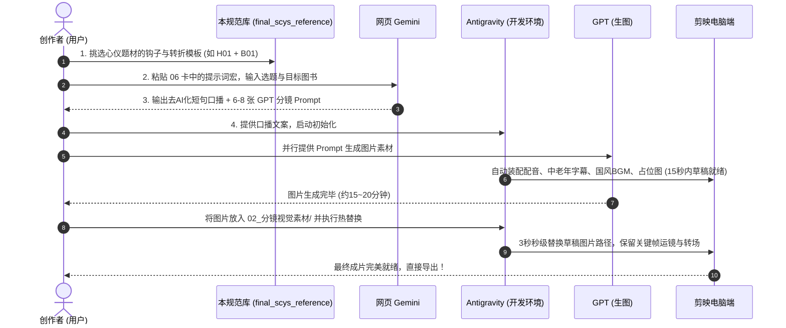

# 爆款视频口播逆向规范与流水线标准参考库（终版）

> **建立时间**：2026-10-23  
> **数据基石**：全量 343 篇头部爆款视频口播语料（读史明智、锦绣千秋录、食力过日子、元宝资治通鉴）  
> **工作流阶段**：第 3 棒 - Antigravity 交叉互检与终版落盘  
> **核心使命**：将 Codex 的初审结论与全量语料进行交叉核验，补齐被遗漏的特色场景与爆款母体，形成**可直接挂载到短视频极速生产流水线（`fast_draft_pipeline.py`）的标准参考规范**。

---

## 📂 规范文件导航表

| 序号 | 规范文件名（点击直达） | 核心定位与模块内容 | 适用场景 |
| :---: | :--- | :--- | :--- |
| **00** | [**`00_互检修正说明.md`**](00_互检修正说明.md) | **双 Agent 交叉互检复盘报告** 详细列出 Codex 初稿在数据去噪上的贡献，以及在《食力过日子》生活场景、《元宝》成事七律等方面的遗漏点与深度补正说明。 | 流程复盘与核验追溯 |
| **01** | [**`01_全能爆款口播骨架与丝滑转折总库.md`**](01_全能爆款口播骨架与丝滑转折总库.md) | **全赛道通用核心库（必读）** • 硬指标：7.2~8.1 字分句、1,400~1,800 字篇幅； • **16 大万能黄金钩子公式**（前 120 字开篇即用）； • **16 大丝滑带货转折桥**（生活痛点自然引出图书）； • **3 大高效逼单范式**（快餐玩具比价法、人生防身法、岁月留白法）； • 去 AI 味口语连接词与气口禁忌表。 | 日常写稿与模板检索第一站 |
| **02** | [**`02_赛道规范_读史明智_评书悬念与人物反差.md`**](02_赛道规范_读史明智_评书悬念与人物反差.md) | **历史人物与通史图书专项** • 三大骨架：小人物卑微逆袭型、善终避祸急流勇退型、正史谎言翻案型； • 评书下饭式开场与帝国崛起强心针逼单话术。 | 《史记》《百家讲坛》人物类图书带货 |
| **03** | [**`03_赛道规范_锦绣千秋录_国风山水与半生诗意.md`**](03_赛道规范_锦绣千秋录_国风山水与半生诗意.md) | **名城古建与诗词地理专项** • 标志性仪式感口播（*“话不多说，茶给您沏好了……”*）； • 倒叙榜单揭晓法（第5名到第1名高潮前转折）； • 古建超级工程与老两口案头画册陪伴转化。 | 《中国国家地理》《古诗里的中国》图集带货 |
| **04** | [**`04_赛道规范_食力过日子_银发生活与烟火出游.md`**](04_赛道规范_食力过日子_银发生活与烟火出游.md) | **银发族与烟火市井专项（深度补齐）** • **四大特色出游模板**：带孙辈长见识游、冬季暖汤温泉小城、乡村大集风俗游、城市过早排队游； • **快餐玩具比价法**强共情逼单杀招。 | 亲子研学、旅行攻略、生活风物图书带货 |
| **05** | [**`05_赛道规范_元宝与资治通鉴_成事七律与心性认知.md`**](05_赛道规范_元宝与资治通鉴_成事七律与心性认知.md) | **处世心性与通识思维专项（深度补齐）** • **“成事七律 / 人生局”工业化复制模板**（稳、忍、明、决，单字破题+痛点共情+博弈深拆+大字本逼单）； • 适老反爬坡无障碍旅行榜单； • 文化常识三道题代际互动模板。 | 《资治通鉴》《中华文化1000问》智谋类图书 |
| **06** | [**`06_极速管线挂载规范与Gemini分镜提示词卡.md`**](06_极速管线挂载规范与Gemini分镜提示词卡.md) | **极速工程生产对接卡（直接调用）** • 标准声学参数（`zh-CN-YunjianNeural`，-8% 语速，-6Hz 音调）与 BGM 规范（`bgm_shili_guofeng.mp3`，-13.0dB）； • 网页 Gemini 改稿与 GPT 分镜生图 Prompt 宏模板； • 15 秒草稿初始化与 3 秒图片热替换操作指南。 | 视频工程秒级装配与出片 |

---

## 🚀 极速视频生产黄金管线闭环

当你想制作一条新视频时，只需执行以下极简三步走：

